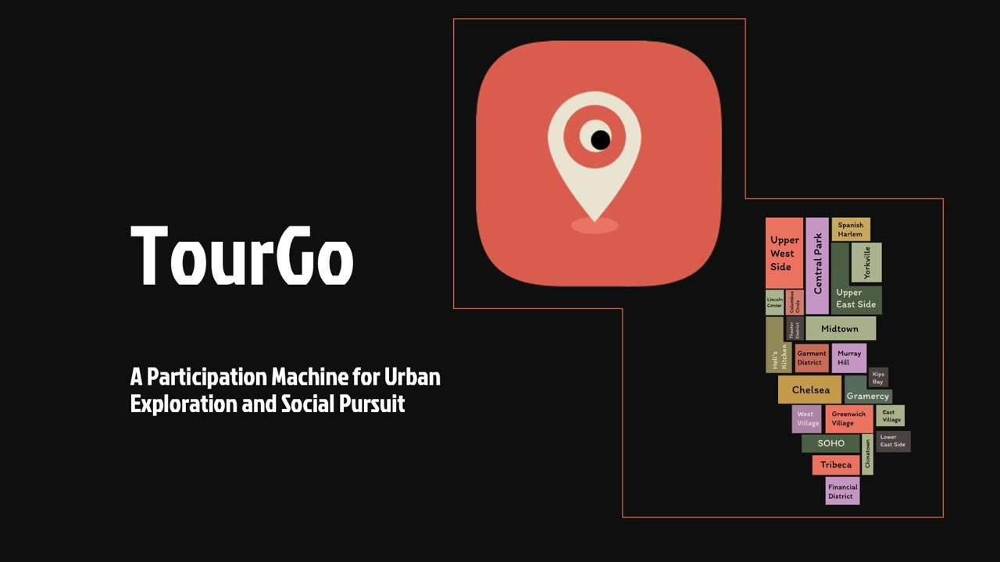
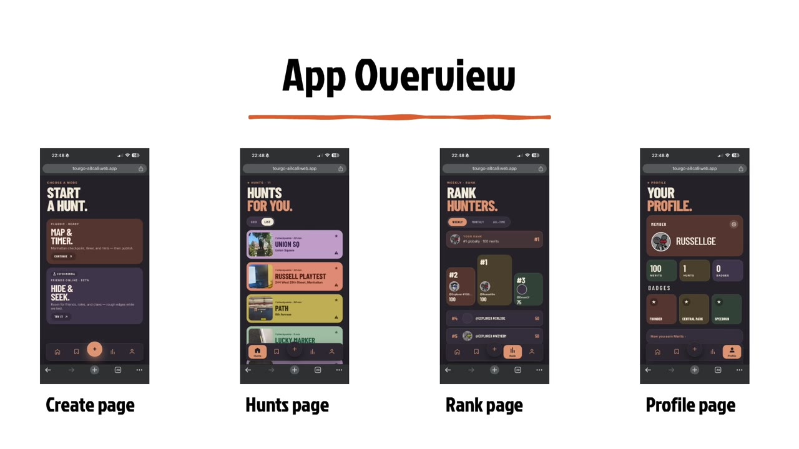
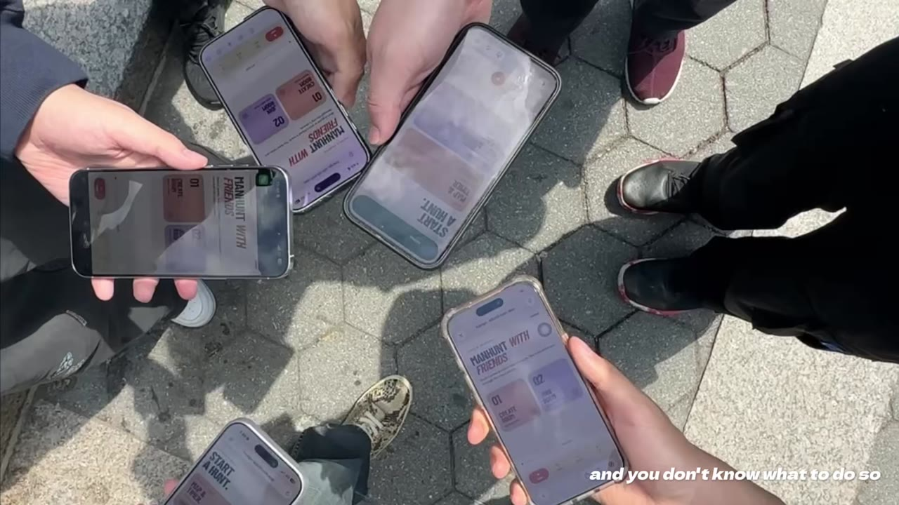
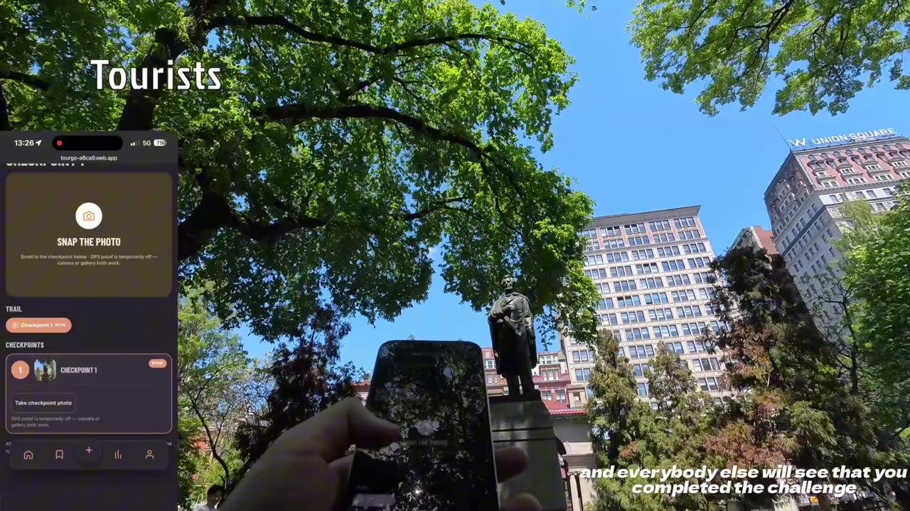
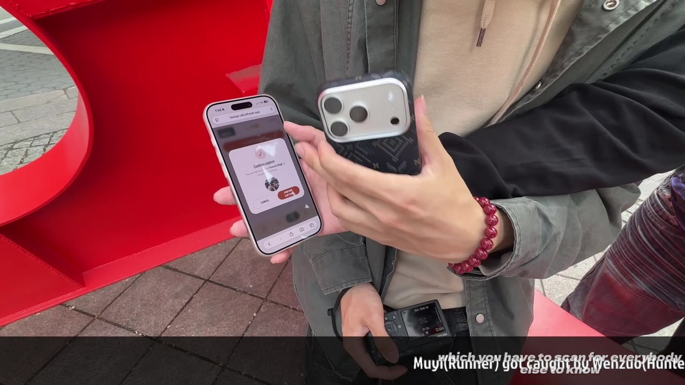

# Tourgo

**A Participation Machine for Urban Exploration and Social Pursuit**

在纽约曼哈顿真实街头玩的手机网页游戏平台：一边是**限时拍照寻宝（Hunts）**，一边是好友之间的**真人抓人（Manhunt）**。两个玩法共用同一个 Firebase 后端。



- 在线体验：https://tourgo-a8ca9.web.app（手机竖屏打开）
- 主应用入口：`/NeoUI/`；Friend / Manhunt 子应用入口：`/game/`
- Parsons · Participation Studio / Lab · Project 3「Participation Machine」· Spring 2026

---

## 两种玩法

| | Hunts · 找地点 | Manhunt · 找人 |
|---|---|---|
| 怎么玩 | 本地人拍下喜欢的角落，写提示、设时限，发布成挑战；其他人接受挑战，在时限内找到并拍照打卡，获得 Merit | 好友建房间、拍头像、各自散开；身份揭晓后 Hunter 追捕 Runner，扫 Runner 的二维码完成抓捕 |
| 想引发的情绪 | 好奇、发现、探索、重新理解熟悉的地方 | 紧张、不确定、追逐、疑神疑鬼、兴奋、社交压力 |
| 核心界面 | 首页（列表 / 网格 / 地图）· 详情 · Run 倒计时 · 复盘 · 创建 · 收藏 · 排行 · 个人页 | 大厅 · 建房 / 加入 · 准备 · 分散 · 身份揭晓 · 追捕 · 僵局 · 观战 · 社交聊天 |

| Hunts | Manhunt |
|---|---|
|  |  |
|  |  |

> 城市既是界面，也是棋盘：街道、公园、地标和公共设施都是玩法系统的一部分。

---

## 团队

| 成员 | 分工 |
|---|---|
| Muyi | Producer · Web development |
| Wenzuo | UI development · Testing |
| Russell | Documentation · Testing |
| Longren | Group coordination · App flow conceptualization |
| Edmond | App flow conceptualization · Quality assurance |

---

## 项目过程

- **2026-04-03** 提案 “The Tourist Manhunt”（手绘草图 + 团队协议）
- **04-08** 第一个软件模型：单文件原型，跑通“开始 → 倒计时 → 拍照打卡 → 获得 Merit”
- **04-13** Playtest 1（教室）→ 根据反馈加入网页内拍照、排行榜、多人模式
- **04-15 ~ 04-20** 迭代 1：分层架构、云函数、曼哈顿地图、第一代 Classical 设计系统
- **04-23 起** 用 Claude Design 重做全部界面 → NeoUI（主应用 29 屏 + Friend 37 屏，浅 / 深两版）
- **04-29** Playtest 2：室内测试 Manhunt
- **05-11** 正式版 + 联合广场实拍的项目视频

完整过程见 [`portfolio/Tourgo作品集内容.pdf`](portfolio/Tourgo作品集内容.pdf)（44 页）和 [`portfolio/作品集内容梳理.md`](portfolio/作品集内容梳理.md)；每个构建号的变化见 [VERSIONS.md](VERSIONS.md)。

---

## 快速开始

### 本地运行

```bash
# 安装 Firebase CLI（一次即可）
npm install -g firebase-tools

# 本地服务
firebase serve --only hosting

# 打开 http://localhost:5000/NeoUI/ —— 主应用
#   或 http://localhost:5000/game/  —— Friend 子应用
```

项目**不使用打包工具**，改完源码直接刷新浏览器即可。

### 部署

```bash
# 只更新前端
firebase deploy --only hosting

# 同步 Firestore + Storage 规则 + 前端
firebase deploy --only firestore:rules,storage,hosting

# 后端 Functions（头像校验、管理员接口等）
firebase deploy --only functions
```

### 缓存破坏

每次前端改动之后，bump 两个 HTML 的查询串，否则浏览器 / Service Worker 可能继续用旧缓存：

- `public/NeoUI/app.html` → `../css/app.css?v=...` 和 `../js/app.js?v=...`
- `public/game/index.html` → `./hide-seek.css?v=...` 和 `./js/app.js?v=...`

---

## 技术栈

| 层 | 选型 |
|---|---|
| 前端 | 原生 ES Modules（无 Vite / Webpack）、单页 SPA、hash 路由 |
| 样式 | 原生 CSS + 自定义属性（tokens）；分层 @import；NeoUI 主题，浅 / 深两种模式；Barlow Condensed / DM Sans 字族 |
| 地图 | Leaflet 1.9.x + OpenStreetMap；自制曼哈顿分区地图 |
| 后端 | Firebase（Auth / Firestore / Storage / Hosting / Functions） |
| 云函数 | Node.js（`functions/`）：管理员接口、Google Cloud Vision 头像人脸校验 |
| 身份 | Google Sign-In + reCAPTCHA v3 / 访客；Friend 子应用用 Firebase 匿名登录 |
| 真实到场校验 | 开始 Hunt 需在起点 150 m 内；照片 EXIF 校验（200 m、20 分钟内拍摄）和“只限曼哈顿”已实现，开关在 `public/js/lib/geo-flags.js`，目前为测试关闭 |
| 质量 | Sentrux 架构检查 + GitHub Actions |

---

## 仓库地图

```
/
├── README.md              ← 当前文件
├── ARCHITECTURE.md        ← 架构文档（目录结构 / 模块依赖 / CSS 分层 / Firebase 服务）
├── VERSIONS.md            ← 版本日志（每个 cache-bust 构建号对应的功能变化）
├── 项目说明书.md           ← 产品说明（界面清单与依赖边界）
├── Tourgo-UI-Design-Reference.pdf ← 48 页上线界面截图
│
├── firebase.json          ← Hosting / Functions / 规则部署配置
├── firestore.rules        ← Firestore 安全规则
├── firestore.indexes.json ← Firestore 索引
├── storage.rules          ← Storage 安全规则
├── storage-cors.json      ← Storage CORS
│
├── functions/             ← 云函数（Node.js）
│
├── public/
│   ├── NeoUI/             ← 主应用入口（index.html 登录门、app.html 主应用）
│   ├── game/              ← Friend / Manhunt 子应用（js/ 下分 lib / actions / render 三层）
│   ├── css/               ← 主应用 CSS（分层 @import）
│   ├── js/                ← 主应用 JS（lib / services / components / pages）
│   ├── assets/ img/ vendor/
│   └── index.html         ← 根入口（跳转到 /NeoUI/）
│
├── tools/                 ← 独立工具（曼哈顿地图编辑器、地图拼接脚本等）
├── portfolio/             ← 作品集材料（PDF、内容梳理、视频截帧）
└── _design-extract/ _design-v2/   ← 设计稿归档（第一代设计系统 / NeoUI 设计稿），不参与构建
```

---

## 两个应用的关系

主应用和 Friend 子应用**共享同一个 Firebase 项目**（`tourgo-a8ca9`），但各自有独立的 HTML 入口、CSS 和 JS 模块图。Friend 不允许引用主应用的模块。

它们**共用**：

- Firebase Auth 账号（匿名 uid 在 Friend 里直接可用；已登录的主应用 uid 在 Friend 里也可用）
- 主应用 `users/{uid}` 里的 `displayName`（Friend 的 “Same as Tourgo” 模式订阅它）

数据分开存放：主应用用 `challenges` / `attempts` / `users` 等集合；Friend 用 `hideSeekRooms` / `hideSeekPresence` / `hideSeekFriendIndex` / `hideSeekChats`。

---

## 开发约定

- **先读 ARCHITECTURE.md 再改代码**，尤其是添加页面 / 服务 / CSS 层时。
- **只做单向依赖**：`lib → services → components → pages → app.js`，禁止反向或循环。
- **不要绕过 services 层调 Firebase SDK**。
- **每次前端改动 bump 缓存破坏字段**；有规则改动就同步 `firebase deploy --only firestore:rules,storage,hosting`。
- **不要删 `data-app-build` 属性**，它用来排查用户到底在跑哪个版本。
- **动画**必须包 `@media (prefers-reduced-motion: reduce)` 守卫。
- 主应用 `shell.js` 每次路由都会替换页面 DOM，不能给 `.app-dock` 加入场 keyframe。

---

## 许可 / 致谢

Parsons 课程项目，未附开源协议。第三方资源：

- Leaflet (BSD-2-Clause)
- OpenStreetMap (ODbL)
- Google Fonts (OFL)
- Firebase JS SDK (Apache-2.0)
